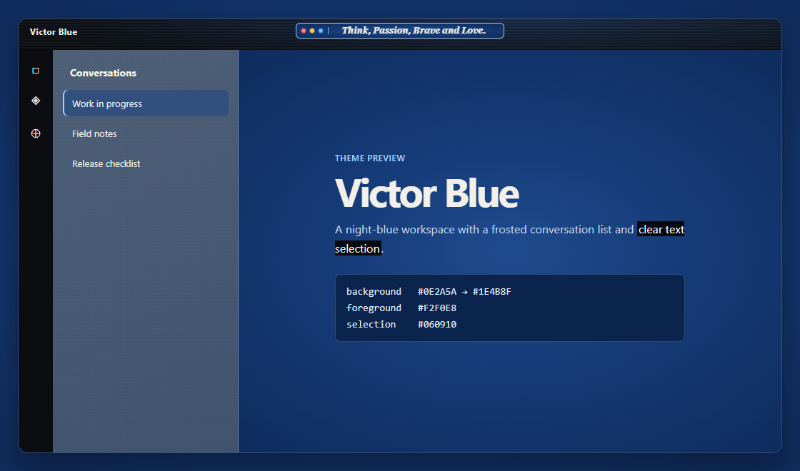

# Victor Blue

*A night-blue theme for Codex Desktop. Think, Passion, Brave and Love.*

**[Download Victor Blue](https://github.com/victorzhang016-code/victor-blue/releases/latest)**

The theme applies a radial night-blue background, a frosted conversation list, a near-black navigation rail, and a clearly marked text selection. Codex draws the styles inside its own window.

## Get started

1. Make sure the official Codex desktop app is installed and has been opened at least once. For the closest match to the preview, choose **Dark** in Codex's Appearance settings.
2. Fully quit Codex. On Windows, use **Quit** from the system tray if closing the window leaves it running. On Mac, use **Quit** from the application menu.
3. Download and extract the right release archive. On Windows, double-click **Start Victor Blue.cmd**. On Mac, open **Start Victor Blue.command**. Keep the launcher window open while using the theme.
4. If the themed window asks you to sign in the first time, choose your usual Codex account. Victor Blue uses a separate renderer profile and points the app at your existing local Codex data directory, so local chats are not copied into an empty test profile.

| Download | Status |
| --- | --- |
| Windows x64 | Tested with the official Microsoft Store build 26.1111.2228.0 |
| macOS Apple silicon | Preview. Package and launcher checks passed on Windows; a Mac run is still pending |
| macOS Intel | Preview. Package and launcher checks passed on Windows; a Mac run is still pending |

The release archives include the Node.js runtime. The GitHub source archive requires Node.js 22 or newer. If you prefer launching from a Mac terminal, run `/bin/bash "./Start Victor Blue.command"` in the extracted folder.

## Returning to the default

Fully quit the themed Codex, then open Codex from its regular shortcut. The launcher applies the theme for that process through a local debugging connection. It does not patch the installed app or edit the Codex configuration file. It refuses to start while the regular app is already running, and it does not close an open Codex process on your behalf.

Only the main renderer receives the stylesheet. The launcher chooses a fresh loopback port and uses a separate renderer profile. A local debugger can be accessed by other software on the same computer while the themed app is running, so quit it when you are done. If an app update changes the renderer structure, parts of the theme may need an update. You can always reopen the regular app after quitting the themed one.

## 中文

**Victor Blue** 是一套 Codex 桌面主题。正文使用从中心向四周渐暗的夜蓝，左侧会话列表用磨砂蓝灰，顶部和导航栏用接近黑色的底，文字选中态也单独处理了。

从 [Releases](https://github.com/victorzhang016-code/victor-blue/releases/latest) 下载对应平台的压缩包并解压。先完全退出正在运行的 Codex，再打开 `Start Victor Blue.cmd`（Windows）或 `Start Victor Blue.command`（Mac）。第一次如果提示登录，请使用原账号。主题入口直接读取原来的本地会话目录，启用主题期间保留启动窗口即可。

Windows 已在 Microsoft Store 正式版上实测。Mac 同时提供 Apple 芯片和 Intel 下载包，目前是预览支持，尚未上 Mac 真机验证。想恢复默认外观时，完全退出主题窗口，再用 Codex 原本的入口打开。

## Development

- `node --test tests/launcher.test.mjs` runs the renderer and endpoint checks.
- `node tests/windows-smoke.mjs` runs against the Store app using a disposable profile and a separate empty data directory.
- `python scripts/package.py` builds the release archives with checksum-verified Node.js binaries.

The theme and launcher are MIT-licensed. Node.js includes its own license in the release archives. Victor Blue is a community project and is not affiliated with OpenAI.
